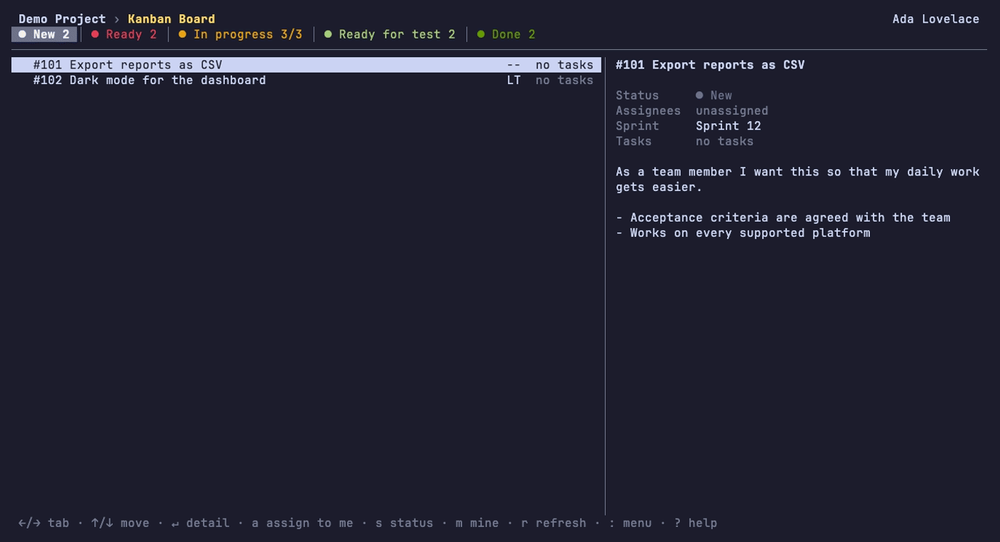

<h1 align="center">taiga-tui</h1>

<p align="center">A keyboard-driven terminal UI for Taiga Taskboards and Kanban Boards.</p>

<p align="center">
  <a href="https://github.com/zeckitoz/taiga-tui/releases/latest"></a>
  <a href="https://github.com/zeckitoz/taiga-tui/actions/workflows/ci.yml"></a>
  <a href="go.mod"></a>
  <a href="LICENSE"></a>
</p>

<p align="center">
  
</p>

## Features

- Taskboard and Kanban Board, with Statuses as columns; the Current Sprint opens first.
- Status Change (`s`) and Assign to me (`a`), plus `m` to show only my items.
- Command menu (`:` or `ctrl+k`) to jump between boards, Sprints and projects.

## Installation

### Homebrew (macOS, Linux)

```sh
brew trust zeckitoz/tap
brew install --cask zeckitoz/tap/taiga-tui
```

Homebrew 7 ignores casks from taps you have not trusted, hence the first line.
The cask removes the macOS quarantine flag after the install, so the binary starts without a warning.

### Scoop (Windows)

```powershell
scoop bucket add zeckitoz https://github.com/zeckitoz/scoop-bucket
scoop install taiga-tui
```

### Debian, Ubuntu and Fedora packages

Download the `.deb` or `.rpm` for your architecture from the [latest release](https://github.com/zeckitoz/taiga-tui/releases/latest).

```sh
sudo dpkg -i taiga-tui_*_linux_amd64.deb              # Debian, Ubuntu
sudo dnf install ./taiga-tui_*_linux_amd64.rpm        # Fedora, RHEL
```

### Direct download

Download the archive for your system from the [latest release](https://github.com/zeckitoz/taiga-tui/releases/latest), unpack it and put `taiga-tui` on your `PATH`.
The binaries are not signed, so the systems warn about them:

- **macOS**: remove the quarantine flag once with `xattr -d com.apple.quarantine taiga-tui`.
- **Windows**: SmartScreen shows "Windows protected your PC".
  Choose "More info", then "Run anyway".

Prefer Homebrew or Scoop, which avoid both warnings.
To check a download, see [Verifying a download](docs/verifying.md).

### From source

```sh
go install github.com/zeckitoz/taiga-tui/cmd/taiga-tui@latest
```

## Usage

Run `taiga-tui` and log in with your Taiga account.
Press `?` for the full key list.
Run `taiga-tui --help` for the flags and the location of the config directory.

### Update hint

At most once a day the app asks GitHub for the latest release in the background.
If a newer version exists, the status line says so: `vX.Y.Z available - see github.com/zeckitoz/taiga-tui/releases`.
The check never blocks the start and stays silent when it fails.
Pre-releases and development builds are ignored.

To turn it off, set this in `config.toml` in the config directory:

```toml
check_updates = false
```

## Under the hood

- [Bubble Tea](https://github.com/charmbracelet/bubbletea): the terminal UI framework.
- [Lip Gloss](https://github.com/charmbracelet/lipgloss): styling and layout.
- [Bubbles](https://github.com/charmbracelet/bubbles): the text input.
- [go-keyring](https://github.com/zalando/go-keyring): stores the login in the system keychain.
- [BurntSushi/toml](https://github.com/BurntSushi/toml): reads `config.toml`.
- [vhs](https://github.com/charmbracelet/vhs): records the demo, see [`docs/media/demo.tape`](docs/media/demo.tape).
- [GoReleaser](https://goreleaser.com): builds the releases, see [Releasing](docs/releasing.md).

## Roadmap

These are ideas, not commitments.
Open an issue for what you want most.

- Rendered Markdown in User Story and Task descriptions, via [glamour](https://github.com/charmbracelet/glamour).
- Live updates: see your teammates' changes without reloading.
- Creating and editing User Stories and Tasks, plus comments.
- Unassign, the inverse of Assign to me, and undo for a Status Change.
- Epics and Issues next to User Stories and Tasks.
- Furthest away: a dedicated `taiga-cli` tool for scripting against the Taiga API.

## License

MIT, see [LICENSE](LICENSE).
